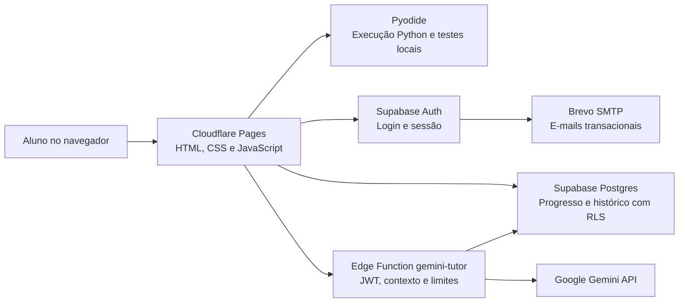

# Arquitetura do IA Tutor

Este documento descreve a **implementação observável no repositório** para apoiar a defesa e o capítulo de desenvolvimento do TCC II. O protótipo não adota React/Next.js ou um servidor Python para processar o exercício: a interface é estática, a execução de Python ocorre no navegador e a integração com Gemini ocorre em uma função de servidor.

## Visão geral

**Cloudflare Pages** entrega páginas e arquivos estáticos. O **Supabase Auth** autentica as contas. O **Postgres** persiste dados individuais com políticas Row-Level Security (RLS). A **Edge Function** autentica a chamada, constrói instruções pedagógicas, encaminha perguntas à API Gemini e registra a conversa. A chave Gemini fica em segredo do servidor e não no navegador.

## Divisão por responsabilidades

| Camada | Arquivos | Função |
| --- | --- | --- |
| Apresentação | `web/*.html`, `web/*.css` | Páginas, navegação, estilos e responsividade |
| Conteúdo didático | `web/problems.js`, `web/study-guide.js` | Desafios, enunciados, testes, dicas, resumos e exemplos |
| Estado e interação | `web/app.js`, `web/learning-ui.js`, `web/preflight-review.js`, `web/code-editor.js` | Fluxo de resolução, revisão, editor, feedback e controles |
| Execução local | `web/runner.js` | Pyodide/WebAssembly, execução de código e avaliação de casos de teste |
| Identidade e progresso | `web/auth-client.js`, `web/access-client.js`, `web/progress-store.js`, `web/module-progress.js`, `web/perfil.js` | Sessão, permissões, persistência e indicadores |
| Tutoria remota | `web/tutor.js`, `supabase/functions/gemini-tutor/index.ts` | Chamada autenticada, instruções socráticas e Gemini |
| Banco e regras | `supabase/*.sql` | Estrutura, acesso controlado, currículo e migrações de suporte |
| Infraestrutura | `scripts/build_site.py`, `scripts/smoke_site.py`, `.github/workflows/preflight.yml` | Build, verificação HTTP e integração contínua |

`app.js` é o **orquestrador** da área de desafios; centraliza eventos da interface, execução e salvamento. Uma separação maior dele exigiria mudanças no contrato entre estados e componentes. Na refatoração final optou-se por **não introduzir uma arquitetura de módulos/importações nem bundler**, pois aumentaria risco e complexidade sem benefício comprovado para o objetivo do TCC.

## Fluxo 1 — Resolver um exercício

1. O usuário autenticado seleciona um desafio autorizado pelo currículo.
2. `problems.js` fornece enunciado, apoio e casos de teste.
3. O estudante escreve Python no editor (CodeMirror).
4. `runner.js` utiliza Pyodide no navegador para executar o programa nos casos de teste.
5. `app.js` compara resultados esperados/obtidos, atualiza a interface e inicia a persistência do progresso no Supabase.
6. A conclusão é mantida mesmo se uma tentativa posterior falhar, conforme testes de regressão.

**Limitação:** os casos de teste e a execução ficam disponíveis no cliente; portanto, não são uma avaliação segura no servidor. Progresso serve ao acompanhamento educacional e não à certificação antifraude.

## Fluxo 2 — Interação com o Professor Socrático

1. O aluno faz uma pergunta no `tutor.html`.
2. `web/tutor.js` encaminha os dados para `gemini-tutor` com a sessão autenticada.
3. A função valida o usuário (JWT), o formato e o tamanho da mensagem; verifica limites simples por conta, carrega contexto e algumas mensagens anteriores.
4. Conforme o tipo de solicitação, a função pode devolver uma orientação local ou enviar um prompt à API Gemini.
5. A resposta é filtrada por heurísticas simples contra código pronto; a conversa é registrada em `chat_messages` e exibida ao aluno.

No código implantado, o limite individual consultado é de **6 respostas do tutor por minuto** e **80 em 24 horas**, com contagem simples no banco. Esses controles não são transacionais e **não asseguram limite global nem resistência a alta concorrência**. As cotas do Gemini são independentes e dependem da conta/projeto da Google.

**Limitações pedagógicas:** prompts e bloqueios heurísticos não impedem todos os possíveis desvios de resposta nem demonstram desenvolvimento de autonomia do estudante.

## Banco de dados e segurança

- O Supabase Auth mantém contas/sessões.
- `profiles` registra informações de perfil, `exercise_progress` o estado por exercício e `chat_messages` as interações.
- `developer_accounts` e `exercise_access_rules` sustentam permissões e desbloqueios; funções SQL expõem consultas específicas à aplicação.
- RLS deve impedir que uma conta consulte diretamente o progresso ou as mensagens de outra conta; confirmar isso em testes reais, não apenas por análise estática.
- `supabase-config.js` contém apenas URL/chave publicável. A chave `GEMINI_API_KEY` fica exclusivamente nos *secrets* da Edge Function.

A cópia de arquivos SQL no GitHub **não aplica mudanças ao banco**. As migrações históricas não devem ser reexecutadas indiscriminadamente. A Edge Function é publicada separadamente, e sua versão em produção pode divergir do arquivo no Git; registrar a versão ao homologar.

## Construção e publicação

O Cloudflare Pages executa `python3 scripts/build_site.py`, que:
1. lê a lista explícita dos **34 arquivos públicos** de `web/`;
2. valida referências internas de HTML e a existência dos arquivos;
3. gera `dist/` com os mesmos caminhos relativos usados pelo navegador, além de `_headers`;
4. não publica `docs/`, `tests/`, `scripts/` ou `supabase/`.

Isso separa o **código-fonte** do **artefato publicado** (*build reproducível e lista permitida/fail-closed*). A estrutura local mudou, mas as URLs existentes não precisam mudar.

## Critérios de engenharia utilizados

- **Separação de responsabilidades (SoC):** código de interface, serviços, testes e artefatos acadêmicos não se misturam.
- **KISS (Keep It Simple):** arquivos estáticos e comandos diretos; nenhum framework ou configuração desnecessária.
- **YAGNI (You Aren’t Gonna Need It):** o fluxo de pesquisa com participantes foi retirado da versão atual porque não pertence ao escopo do TCC II.
- **Confiabilidade:** preservação dos nomes públicos, CI de regressão e build com whitelist.
- **Reprodutibilidade:** instruções de execução, limites e critérios de validação documentados.

A documentação do TCC deve distinguir o que foi **implementado**, o que foi **testado** e o que permanece **limitação**. A estrutura de diretórios ajuda a explicação, mas, por si só, não é evidência de eficácia do tutor.

Veja também [Operação](OPERACAO.md), [Validação](VALIDACAO.md) e [Decisões da refatoração](DECISOES_REFATORACAO.md).
