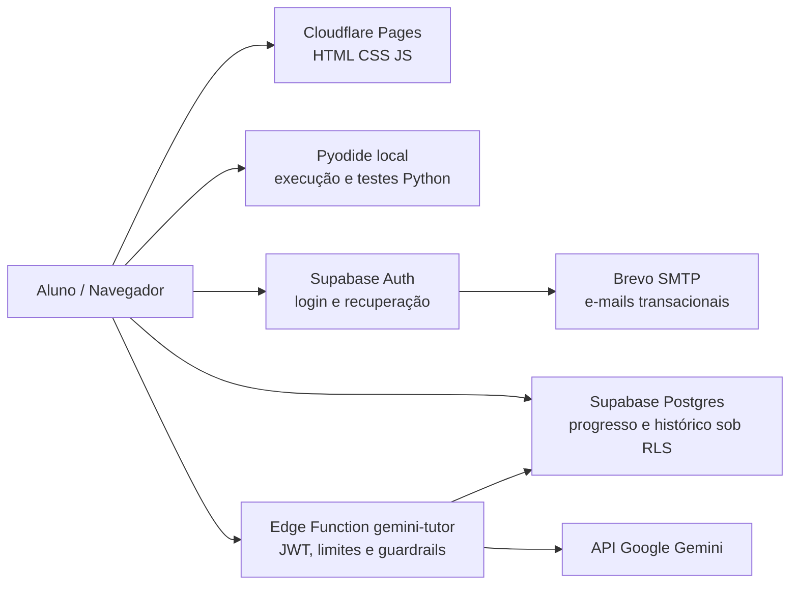

# Arquitetura de software do IA Tutor

> Documento de referência técnica do protótipo de TCC II. Descreve a implementação versionada; não equivale a teste de carga, auditoria de segurança ou avaliação pedagógica com estudantes.

## Objetivo e fronteiras

O IA Tutor fornece uma trilha introdutória de exercícios Python e suporte pedagógico gradual. A aplicação é uma **SPA? Não**: há seis páginas HTML estáticas com scripts de orquestração no navegador, autenticação e dados gerenciados pelo Supabase e tutoria por API externa. A separação por responsabilidades reduz o número de serviços próprios e mantém a execução de Python próxima do aluno.

## Fluxo e visão de contexto

O Cloudflare Pages hospeda arquivos estáticos e não executa o Python dos estudantes. No navegador, `runner.js` usa Pyodide (Python em WebAssembly); os resultados dos testes determinam o estado local de conclusão, depois persistido no Supabase. O Professor Socrático é um fluxo independente e opcional.

## Componentes e responsabilidades

| Componente | Arquivos principais | Responsabilidade e comunicação |
| --- | --- | --- |
| Identidade e sessão | `login.html`, `reset-password.html`, `auth-client.js` | Login, cadastro, recuperação, sessão e redirecionamento autorizado via Supabase Auth |
| Autorização do curso | `access-client.js`, `supabase/developer-access.sql` | Papéis e desbloqueio progressivo por funções RPC e regras do banco |
| Catálogo curricular | `problems.js`, `conteudos.html` | 16 desafios com identificação, enunciados, restrições, dicas, exemplos e testes; módulos 1–5 + desafio final |
| Interface de estudo | `tutor.html`, `app.js`, `learning-ui.js`, `study-guide.js`, `preflight-review.js` | Estado da atividade, revisões, exemplos e teoria, fluxo de dicas, feedback e navegação |
| Editor e execução | `code-editor.js`, `runner.js`, respectivos CSS | Editor CodeMirror e execução de testes no browser via Pyodide; sem servidor próprio de avaliação |
| Persistência e perfil | `progress-store.js`, `module-progress.js`, `perfil.js` | Salva rascunhos, conclusões, indicadores e apresenta progresso individual |
| Cliente do tutor | `tutor.js` | Envia mensagens autenticadas por `functions.invoke("gemini-tutor")`; não contém chave Gemini |
| Serviço de tutoria | `supabase/functions/gemini-tutor/index.ts` | Verifica identidade JWT, consulta histórico do aluno/exercício, aplica instruções, chama Gemini e grava mensagens |
| Operação | `scripts/build_site.py`, `scripts/smoke_site.py`, `.github/workflows/preflight.yml` | Empacotamento com whitelist, verificação HTTP pública, CI e artefatos de build |

## Fluxos principais

### A. Cadastro e acesso
1. O aluno acessa a tela de login e autentica-se pelo Supabase Auth.
2. `auth-client.js` garante sessão e redireciona visitantes não autenticados.
3. `access-client.js` consulta RPCs `get_tutor_access` e `can_access_exercise`; o banco decide as regras de desbloqueio.
4. Os dados próprios de progresso/histórico são isolados por políticas RLS; não dependem de variáveis no navegador para autorizar a leitura de outra conta.
5. O e-mail transacional é enviado pelo Supabase Auth via Brevo SMTP, com domínio autenticado por DNS.

### B. Resolver e verificar um exercício
1. O estudante seleciona um desafio dentre os objetos de `problems.js`.
2. `app.js` inicializa orquestração, revisão prévia e editores.
3. O código é executado **localmente** em `runner.js`, com casos de teste do currículo.
4. A interface apresenta entrada, saída esperada, saída produzida e eventuais erros.
5. `progress-store.js` persiste o estado do exercício; após conclusão o fluxo atualiza permissão e progresso.

**Limitação essencial:** casos de teste estão acessíveis no cliente e o resultado não é verificado por um avaliador protegido no servidor. Isto é adequado para feedback formativo do protótipo, mas insuficiente como avaliação antifraude ou certificação.

### C. Conversar com o Professor Socrático
1. O aluno pergunta pelo cliente `tutor.js` usando sua sessão autenticada.
2. A Edge Function verifica JWT, valida conteúdo/tamanho e consulta mensagens recentes associadas à conta e à versão do currículo.
3. Solicitações diretas de gabarito podem receber resposta padronizada; as demais seguem para a API Gemini com instruções de comportamento socrático.
4. A resposta é revisada heurísticamente para evitar código pronto em determinadas situações.
5. O par de mensagens do aluno e do tutor é salvo em `chat_messages`, associado ao usuário autenticado.

A função possui limites de **6 respostas em 60 segundos e 80 respostas em 24 horas por aluno**, contados por mensagens do assistente. Esses limites não são atômicos; chamadas simultâneas podem concorrer antes da gravação. Há tentativas limitadas de retry para indisponibilidade transitória do provedor. As cotas reais RPM/TPM/RPD do Gemini são **compartilhadas** no projeto Google.

### D. Indicadores instrumentados
O objeto de métricas por exercício em `app.js` contém:

- `hints_used`: número de dicas solicitadas;
- `code_submissions`: envios de código;
- `idea_submissions`: ideias registradas para avaliação;
- `blocked_direct_answer_attempts` e `direct_answer_attempts`: eventos classificados pela heurística de pedidos diretos;
- `reengagement_after_block`: interações após bloqueios registrados;
- `idle_time_seconds`: estimativa de inatividade observável na aba ativa.

Há funções derivadas para razão de bloqueios e reengajamento. São **indicadores operacionais**, não medidas validadas de aprendizagem, atenção, autonomia ou intenção do aluno. Versões antigas do currículo podem não conter todas as métricas atuais.

## Segurança, qualidade e operação

- A chave Gemini fica em **Supabase Edge Function Secrets**, nunca em HTML/JavaScript público.
- JWT e políticas RLS protegem a identidade e o acesso aos dados do aluno. Autenticação e autorização são controles distintos.
- O build `scripts/build_site.py` copia **somente** os arquivos enumerados em `OUTPUT_FILES` para `dist/`; documentos, SQL e testes ficam fora da publicação.
- O CI executa verificações estáticas, teste Node da conclusão persistente e construção do pacote. Isso **não** comprova que serviços externos e navegador funcionam no domínio.
- A aplicação depende de CDN para bibliotecas no navegador e de serviços externos para autenticação, LLM e hospedagem.
- A validação funcional final em `https://iatutor.com.br`, a avaliação de capacidade simultânea, acessibilidade e proteção robusta contra abuso permanecem verificações específicas, não presumidas aprovadas.

## Como explicar a solução numa apresentação de engenharia

A explicação mais defensável é seguir o trajeto de **uma requisição**, separando:
1. o que é processamento do **cliente** (Pyodide e interface);
2. o que exige **identidade e persistência** (Supabase + RLS);
3. o que necessita de **segredo e IA externa** (Edge Function + Gemini);
4. o que se considera **resultado verificável** (testes e registros, não promessas pedagógicas).

Complementos: [decisões de engenharia](decisoes-tecnicas.md), [operação](operacao.md), [roteiros de validação](validacao/README.md) e [revisão do currículo](artefatos/revisao-curriculo-v2.md).
